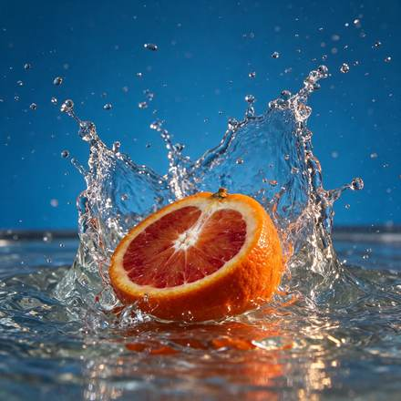

<!-- Generated from external-references/cases.json; not original model output by Raphael. -->
# Freeze a splash for a campaign image

[English](README.md) · [简体中文](README.zh-CN.md)

[Back to external queue](../../README.md)

**Status: pending remake. Model and outputs are source-reported, not independently reproduced.**

## Original reference 1



[Open source image](https://cdn.froging.ai/frogingai/seedream-5-5/v1-20261111/citrus-splash.jpg)

## Source-published prompt

The website associates this prompt with its output; license, model execution and settings were not independently audited.

```text
High-speed editorial food photograph of one cut blood orange half hitting a shallow pool of water, cut surface facing the camera. Capture the moment a translucent crown of water curves around the orange, with individual sharp droplets suspended in the air. Rich ultramarine blue seamless studio backdrop, vivid vermilion pulp and warm side light, natural irregular citrus texture, restrained commercial art direction. Low eye-level camera, square composition, the entire splash inside the frame with breathing room on all sides. One fruit half, no hands, no typography, no logos, no watermark.
```

[Check original source](https://www.froging.ai/seedream-5-5-ai-image-generator)

## Remake and rights

- Source: Froging AI · [https://www.froging.ai/seedream-5-5-ai-image-generator](https://www.froging.ai/seedream-5-5-ai-image-generator)
- Model evidence: site-self-reported
- Workflow: text-to-image
- Media license: not verified
- Remake status: pending
- Owned replacement files: 0

Put new outputs in the remade directory and update structured status. Clear licensing or remove source-media previews before promotion.

Notes: Source claims this is a generated result.
