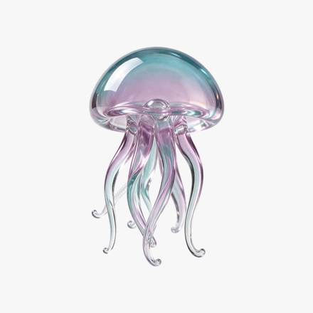

<!-- Generated from external-references/cases.json; not original model output by Raphael. -->
# Create a transparent glass asset

[English](README.md) · [简体中文](README.zh-CN.md)

[Back to external queue](../../README.md)

**Status: pending remake. Model and outputs are source-reported, not independently reproduced.**

## Original reference 1



[Open source image](https://cdn.froging.ai/frogingai/seedream-5-5/v1-20261111/glass-jellyfish.png)

## Source-published prompt

The website associates this prompt with its output; license, model execution and settings were not independently audited.

```text
Create one small seafoam and pale lavender blown-glass jellyfish as an isolated design asset. Show a translucent domed bell and six delicate curved glass tentacles, with polished edges and soft studio highlights. Center the entire silhouette with generous clear margins. Fully transparent background with real alpha outside the object and partial transparency within the thin glass. No floor, no cast shadow, no bubbles, no checkerboard, no frame, no text.
```

[Check original source](https://www.froging.ai/seedream-5-5-ai-image-generator)

## Remake and rights

- Source: Froging AI · [https://www.froging.ai/seedream-5-5-ai-image-generator](https://www.froging.ai/seedream-5-5-ai-image-generator)
- Model evidence: site-self-reported
- Workflow: text-to-image
- Media license: not verified
- Remake status: pending
- Owned replacement files: 0

Put new outputs in the remade directory and update structured status. Clear licensing or remove source-media previews before promotion.

Notes: Source claims this is a generated result.
