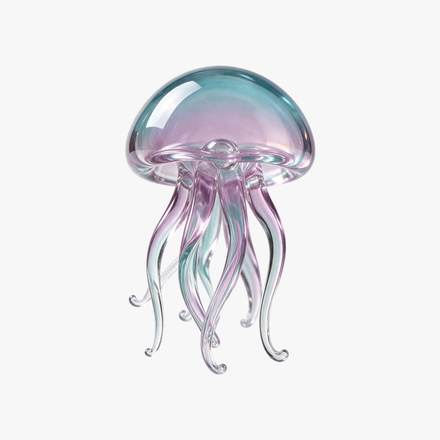

<!-- Generated from external-references/cases.json; not original model output by Raphael. -->
# 透明玻璃水母

[English](README.md) · [简体中文](README.zh-CN.md)

[返回外部素材库](../../README.zh-CN.md)

**状态：待重做。第三方网站自报模型和结果，本站尚未独立复现。**

## 原始参考图 1



[打开来源图片](https://cdn.froging.ai/frogingai/seedream-5-5/v1-20261111/glass-jellyfish.png)

## 来源公开 Prompt

网站将以下文案标注为该结果的提示词；转载许可、生成模型和参数尚未独立审计。

```text
Create one small seafoam and pale lavender blown-glass jellyfish as an isolated design asset. Show a translucent domed bell and six delicate curved glass tentacles, with polished edges and soft studio highlights. Center the entire silhouette with generous clear margins. Fully transparent background with real alpha outside the object and partial transparency within the thin glass. No floor, no cast shadow, no bubbles, no checkerboard, no frame, no text.
```

[核对来源原文](https://www.froging.ai/seedream-5-5-ai-image-generator)

## 重做与授权

- 来源: Froging AI · [https://www.froging.ai/seedream-5-5-ai-image-generator](https://www.froging.ai/seedream-5-5-ai-image-generator)
- 来源模型归因: site-self-reported
- 工作流: text-to-image
- 图像许可: not verified
- 重做状态: pending
- 本次重做文件数: 0

后续生成的新图请放到独立 remade 目录并更新结构化状态；对来源图片的转载应在发布前处理授权或删除。

备注：Source claims this is a generated result.
