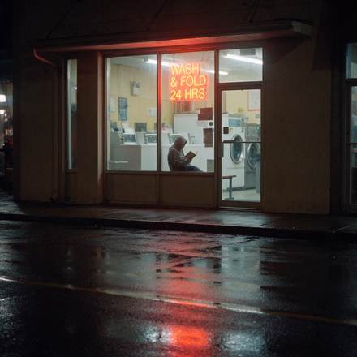

<!-- Generated from external-references/cases.json; not original model output by Raphael. -->
# Neon sign

[English](README.md) · [简体中文](README.zh-CN.md)

[Back to external queue](../../README.md)

**Status: pending remake. Model and outputs are source-reported, not independently reproduced.**

## Original reference 1



[Open source image](https://www.made.app/images/models/seedream-5-5/wash-fold-neon.jpg)

## Source-published prompt

The website associates this prompt with its output; license, model execution and settings were not independently audited.

```text
Laundromat storefront at night seen from across a rainy street, a neon window sign reading exactly "WASH & FOLD 24 HRS", a person in a hoodie reading a paperback on a bench inside, reflections on the wet asphalt, shot on a phone, slight grain, sharp legible sign, no other words or logos.
```

[Check original source](https://www.made.app/models/seedream-5-5)

## Remake and rights

- Source: Made · [https://www.made.app/models/seedream-5-5](https://www.made.app/models/seedream-5-5)
- Model evidence: site-self-reported
- Workflow: text-to-image
- Media license: not verified
- Remake status: pending
- Owned replacement files: 0

Put new outputs in the remade directory and update structured status. Clear licensing or remove source-media previews before promotion.

Notes: Made reports in-house model samples with generation record prompts.
