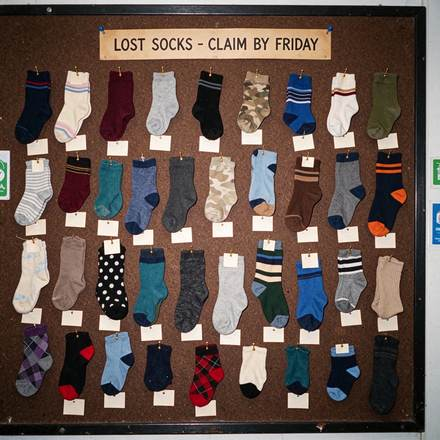

<!-- Generated from external-references/cases.json; not original model output by Raphael. -->
# 袜子失物招领展示板

[English](README.md) · [简体中文](README.zh-CN.md)

[返回外部素材库](../../README.zh-CN.md)

**状态：待重做。第三方网站自报模型和结果，本站尚未独立复现。**

## 原始参考图 1



[打开来源图片](https://www.made.app/images/models/seedream-5-5/lost-socks.jpg)

## 来源公开 Prompt

网站将以下文案标注为该结果的提示词；转载许可、生成模型和参数尚未独立审计。

```text
Flash photo of a corkboard at a laundromat covered in dozens of single mismatched socks pinned up like butterfly specimens, each with a small blank paper tag, a printed header card at the top reading exactly "LOST SOCKS - CLAIM BY FRIDAY", slight grain, sharp legible header, no other words or logos.
```

[核对来源原文](https://www.made.app/models/seedream-5-5)

## 重做与授权

- 来源: Made · [https://www.made.app/models/seedream-5-5](https://www.made.app/models/seedream-5-5)
- 来源模型归因: site-self-reported
- 工作流: text-to-image
- 图像许可: not verified
- 重做状态: pending
- 本次重做文件数: 0

后续生成的新图请放到独立 remade 目录并更新结构化状态；对来源图片的转载应在发布前处理授权或删除。

备注：Made reports in-house model samples with generation record prompts.
