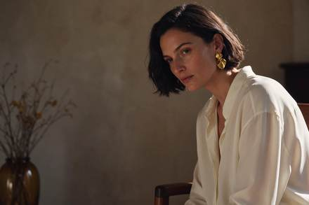

<!-- Generated from external-references/cases.json; not original model output by Raphael. -->
# Editorial portraits

[English](README.md) · [简体中文](README.zh-CN.md)

[Back to external queue](../../README.md)

**Status: pending remake. Model and outputs are source-reported, not independently reproduced.**

## Original reference 1



[Open source image](https://cdn.orylia.ai/research/seedream-5-5/c897c4bc-c281-42fb-957f-ec34c8cd5b98.webp)

## Source-published prompt

The website associates this prompt with its output; license, model execution and settings were not independently audited.

```text
Luxury fashion editorial photograph, adult woman with natural freckles, short dark bob, brushed gold sculptural earrings and an ivory silk blouse, seated beside an amber glass vase in a sunlit modernist interior. Subject on the right third, expansive softly lit warm charcoal negative space on the left for a website headline. Tangible silk weave, natural pores, delicate flyaway hair, golden afternoon rim light, restrained warm ivory and amber palette, 85mm portrait lens, sophisticated magazine art direction. No text, no logo, no watermark.
```

[Check original source](https://orylia.ai/ai-models/seedream-5-5)

## Remake and rights

- Source: Orylia · [https://orylia.ai/ai-models/seedream-5-5](https://orylia.ai/ai-models/seedream-5-5)
- Model evidence: site-self-reported
- Workflow: text-to-image
- Media license: not verified
- Remake status: pending
- Owned replacement files: 0

Put new outputs in the remade directory and update structured status. Clear licensing or remove source-media previews before promotion.

Notes: Orylia reports this as a Seedream 5.5 research output; not independently generated.
