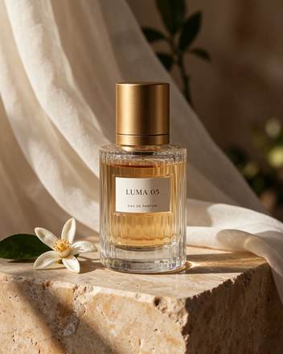

<!-- Generated from external-references/cases.json; not original model output by Raphael. -->
# Product photography

[English](README.md) · [简体中文](README.zh-CN.md)

[Back to external queue](../../README.md)

**Status: pending remake. Model and outputs are source-reported, not independently reproduced.**

## Original reference 1



[Open source image](https://cdn.orylia.ai/research/seedream-5-5/7338d995-e2b2-4d43-b6c8-e30dbbeefb40.webp)

## Source-published prompt

The website associates this prompt with its output; license, model execution and settings were not independently audited.

```text
Premium fragrance campaign still life. A single clear ribbed glass perfume bottle filled with pale amber liquid, brushed gold cylindrical cap, small ivory label reading exactly "LUMA 05" and below it "EAU DE PARFUM". Bottle on warm travertine, sheer ivory fabric behind, one orange blossom beside it. Late afternoon side light, convincing glass refraction and caustics, detailed stone grain, elegant editorial photography. No other lettering. Complete bottle and cap visible.
```

[Check original source](https://orylia.ai/ai-models/seedream-5-5)

## Remake and rights

- Source: Orylia · [https://orylia.ai/ai-models/seedream-5-5](https://orylia.ai/ai-models/seedream-5-5)
- Model evidence: site-self-reported
- Workflow: text-to-image
- Media license: not verified
- Remake status: pending
- Owned replacement files: 0

Put new outputs in the remade directory and update structured status. Clear licensing or remove source-media previews before promotion.

Notes: Orylia reports this as a Seedream 5.5 research output; not independently generated.
