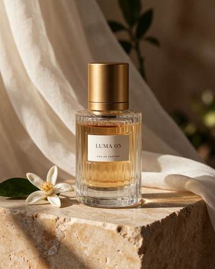

<!-- Generated from external-references/cases.json; not original model output by Raphael. -->
# LUMA 05 玻璃香水广告

[English](README.md) · [简体中文](README.zh-CN.md)

[返回外部素材库](../../README.zh-CN.md)

**状态：待重做。第三方网站自报模型和结果，本站尚未独立复现。**

## 原始参考图 1



[打开来源图片](https://cdn.orylia.ai/research/seedream-5-5/7338d995-e2b2-4d43-b6c8-e30dbbeefb40.webp)

## 来源公开 Prompt

网站将以下文案标注为该结果的提示词；转载许可、生成模型和参数尚未独立审计。

```text
Premium fragrance campaign still life. A single clear ribbed glass perfume bottle filled with pale amber liquid, brushed gold cylindrical cap, small ivory label reading exactly "LUMA 05" and below it "EAU DE PARFUM". Bottle on warm travertine, sheer ivory fabric behind, one orange blossom beside it. Late afternoon side light, convincing glass refraction and caustics, detailed stone grain, elegant editorial photography. No other lettering. Complete bottle and cap visible.
```

[核对来源原文](https://orylia.ai/ai-models/seedream-5-5)

## 重做与授权

- 来源: Orylia · [https://orylia.ai/ai-models/seedream-5-5](https://orylia.ai/ai-models/seedream-5-5)
- 来源模型归因: site-self-reported
- 工作流: text-to-image
- 图像许可: not verified
- 重做状态: pending
- 本次重做文件数: 0

后续生成的新图请放到独立 remade 目录并更新结构化状态；对来源图片的转载应在发布前处理授权或删除。

备注：Orylia reports this as a Seedream 5.5 research output; not independently generated.
