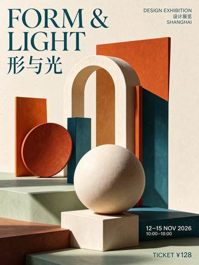

<!-- Generated from external-references/cases.json; not original model output by Raphael. -->
# Bilingual typography

[English](README.md) · [简体中文](README.zh-CN.md)

[Back to external queue](../../README.md)

**Status: pending remake. Model and outputs are source-reported, not independently reproduced.**

## Original reference 1



[Open source image](https://cdn.orylia.ai/research/seedream-5-5/8938c3cc-4f90-4f35-b846-6a840db6acc2.webp)

## Source-published prompt

The website associates this prompt with its output; license, model execution and settings were not independently audited.

```text
Design a premium bilingual exhibition poster on ivory paper, burnt orange and deep teal geometric still-life shapes, meticulous Swiss editorial grid. Include exactly these text lines, each once, with accurate punctuation: "FORM & LIGHT", "形与光", "DESIGN EXHIBITION", "设计展览", "12–15 NOV 2026", "10:00–18:00", "TICKET ¥128", "SHANGHAI". Clear hierarchy, large elegant headline, perfectly readable smaller information, balanced generous margins. No other text, no decorative fake letters.
```

[Check original source](https://orylia.ai/ai-models/seedream-5-5)

## Remake and rights

- Source: Orylia · [https://orylia.ai/ai-models/seedream-5-5](https://orylia.ai/ai-models/seedream-5-5)
- Model evidence: site-self-reported
- Workflow: text-to-image
- Media license: not verified
- Remake status: pending
- Owned replacement files: 0

Put new outputs in the remade directory and update structured status. Clear licensing or remove source-media previews before promotion.

Notes: Orylia reports this as a Seedream 5.5 research output; not independently generated.
