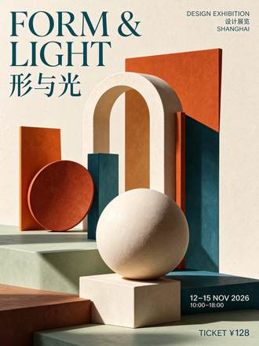

<!-- Generated from external-references/cases.json; not original model output by Raphael. -->
# FORM & LIGHT 中英双语展览海报

[English](README.md) · [简体中文](README.zh-CN.md)

[返回外部素材库](../../README.zh-CN.md)

**状态：待重做。第三方网站自报模型和结果，本站尚未独立复现。**

## 原始参考图 1



[打开来源图片](https://cdn.orylia.ai/research/seedream-5-5/8938c3cc-4f90-4f35-b846-6a840db6acc2.webp)

## 来源公开 Prompt

网站将以下文案标注为该结果的提示词；转载许可、生成模型和参数尚未独立审计。

```text
Design a premium bilingual exhibition poster on ivory paper, burnt orange and deep teal geometric still-life shapes, meticulous Swiss editorial grid. Include exactly these text lines, each once, with accurate punctuation: "FORM & LIGHT", "形与光", "DESIGN EXHIBITION", "设计展览", "12–15 NOV 2026", "10:00–18:00", "TICKET ¥128", "SHANGHAI". Clear hierarchy, large elegant headline, perfectly readable smaller information, balanced generous margins. No other text, no decorative fake letters.
```

[核对来源原文](https://orylia.ai/ai-models/seedream-5-5)

## 重做与授权

- 来源: Orylia · [https://orylia.ai/ai-models/seedream-5-5](https://orylia.ai/ai-models/seedream-5-5)
- 来源模型归因: site-self-reported
- 工作流: text-to-image
- 图像许可: not verified
- 重做状态: pending
- 本次重做文件数: 0

后续生成的新图请放到独立 remade 目录并更新结构化状态；对来源图片的转载应在发布前处理授权或删除。

备注：Orylia reports this as a Seedream 5.5 research output; not independently generated.
