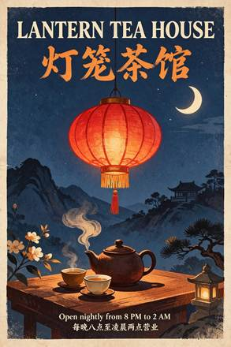

<!-- Generated from external-references/cases.json; not original model output by Raphael. -->
# 中英双语灯笼茶馆海报

[English](README.md) · [简体中文](README.zh-CN.md)

[返回外部素材库](../../README.zh-CN.md)

**状态：待重做。第三方网站自报模型和结果，本站尚未独立复现。**

## 原始参考图 1



[打开来源图片](https://aws.seedreamv5.com/marketing/showcase-seedream-55-poster-1920.webp)

## 来源公开 Prompt

网站将以下文案标注为该结果的提示词；转载许可、生成模型和参数尚未独立审计。

```text
A vintage screen-print travel poster for a fictional tea house, portrait format. At the top, a large bold serif headline in English reading exactly "LANTERN TEA HOUSE". Directly beneath it, a Chinese title in brush calligraphy reading exactly "灯笼茶馆". In the centre, a flat illustration of a glowing red paper lantern with no writing on it, hanging above a steaming clay teapot and two small cups, under a deep indigo night sky with a single crescent moon and a few stars, with saffron and cream accents and a subtle paper grain. At the bottom, two lines of small, clean sans-serif text: the first reading exactly "Open nightly from 8 PM to 2 AM" and the second reading exactly "每晚八点至凌晨两点营业". These four lines are the only text on the poster, with no signs, labels or characters anywhere else. All lettering crisp, correctly spelled and fully legible, generous margins.
```

[核对来源原文](https://seedreamv5.com/seedream-5.5)

## 重做与授权

- 来源: Seedream Studio · [https://seedreamv5.com/seedream-5.5](https://seedreamv5.com/seedream-5.5)
- 来源模型归因: site-self-reported
- 工作流: text-to-image
- 图像许可: not verified
- 重做状态: pending
- 本次重做文件数: 0

后续生成的新图请放到独立 remade 目录并更新结构化状态；对来源图片的转载应在发布前处理授权或删除。

备注：Site presents an exact prompt and the model-generated output.
