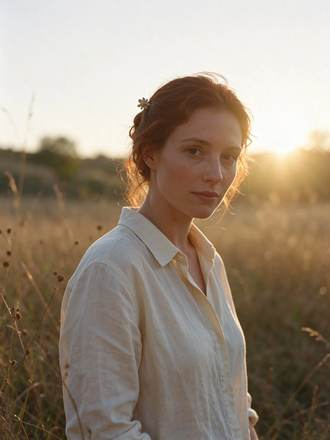

<!-- Generated from external-references/cases.json; not original model output by Raphael. -->
# A backlit portrait

[English](README.md) · [简体中文](README.zh-CN.md)

[Back to external queue](../../README.md)

**Status: pending remake. Model and outputs are source-reported, not independently reproduced.**

## Original reference 1



[Open source image](https://aws.seedreamv5.com/marketing/showcase-seedream-55-portrait-1920.webp)

## Source-published prompt

The website associates this prompt with its output; license, model execution and settings were not independently audited.

```text
A backlit portrait of a woman in her early thirties standing in a meadow of tall grass at golden hour. The low sun behind her creates a bright rim light that outlines her loose auburn hair, her shoulders and the edge of her cream linen shirt. Her face is softly lit by warm bounce light, with natural skin texture and light freckles, a calm expression, looking just past the camera. Warm haze, a gentle lens flare, creamy background bokeh. An original, non-famous person. Photorealistic, 85mm lens at f/1.8, shallow depth of field.
```

[Check original source](https://seedreamv5.com/seedream-5.5)

## Remake and rights

- Source: Seedream Studio · [https://seedreamv5.com/seedream-5.5](https://seedreamv5.com/seedream-5.5)
- Model evidence: site-self-reported
- Workflow: text-to-image
- Media license: not verified
- Remake status: pending
- Owned replacement files: 0

Put new outputs in the remade directory and update structured status. Clear licensing or remove source-media previews before promotion.

Notes: Site presents an exact prompt and the model-generated output.
