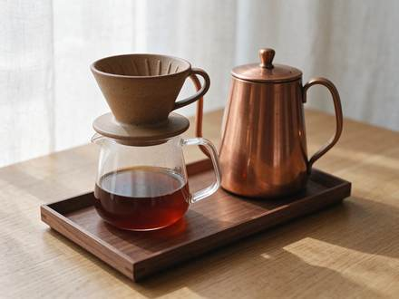

<!-- Generated from external-references/cases.json; not original model output by Raphael. -->
# Glass, ceramic and copper in a product shot

[English](README.md) · [简体中文](README.zh-CN.md)

[Back to external queue](../../README.md)

**Status: pending remake. Model and outputs are source-reported, not independently reproduced.**

## Original reference 1



[Open source image](https://aws.seedreamv5.com/marketing/showcase-seedream-55-product-1920.webp)

## Source-published prompt

The website associates this prompt with its output; license, model execution and settings were not independently audited.

```text
A studio product photograph of a pour-over coffee set on a pale oak tabletop: a matte speckled stoneware dripper with visible glaze pinholes, a clear borosilicate glass carafe half full of amber coffee, a gooseneck kettle in brushed copper with fine circular grain and a soft reflection of the window, and a small walnut tray with crisp wood grain. Soft diffused window light from the left, gentle shadows, a light linen backdrop. Faithful material rendering: the ceramic, glass, metal and wood each look exactly like themselves. No logos, no text, no brand marks. Photorealistic, 100mm macro lens at f/8.
```

[Check original source](https://seedreamv5.com/seedream-5.5)

## Remake and rights

- Source: Seedream Studio · [https://seedreamv5.com/seedream-5.5](https://seedreamv5.com/seedream-5.5)
- Model evidence: site-self-reported
- Workflow: text-to-image
- Media license: not verified
- Remake status: pending
- Owned replacement files: 0

Put new outputs in the remade directory and update structured status. Clear licensing or remove source-media previews before promotion.

Notes: Site presents an exact prompt and the model-generated output.
