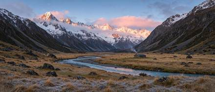

<!-- Generated from external-references/cases.json; not original model output by Raphael. -->
# An ultra-wide 21:9 landscape

[English](README.md) · [简体中文](README.zh-CN.md)

[Back to external queue](../../README.md)

**Status: pending remake. Model and outputs are source-reported, not independently reproduced.**

## Original reference 1



[Open source image](https://aws.seedreamv5.com/marketing/showcase-seedream-55-panorama-1920.webp)

## Source-published prompt

The website associates this prompt with its output; license, model execution and settings were not independently audited.

```text
An ultra-wide 21:9 landscape panorama of a glacier-carved mountain valley at sunrise. Jagged granite peaks dusted with fresh snow catch pink and gold first light, and low clouds cling to the ridgelines. A turquoise braided river winds across a wide valley floor of golden grass and dark boulders, and a single small wooden cabin with a thin line of chimney smoke gives a sense of scale. Crisp detail from the frosted grasses in the foreground to the distant summits. Landscape photography, natural colours, deep focus.
```

[Check original source](https://seedreamv5.com/seedream-5.5)

## Remake and rights

- Source: Seedream Studio · [https://seedreamv5.com/seedream-5.5](https://seedreamv5.com/seedream-5.5)
- Model evidence: site-self-reported
- Workflow: text-to-image
- Media license: not verified
- Remake status: pending
- Owned replacement files: 0

Put new outputs in the remade directory and update structured status. Clear licensing or remove source-media previews before promotion.

Notes: Site presents an exact prompt and the model-generated output.
