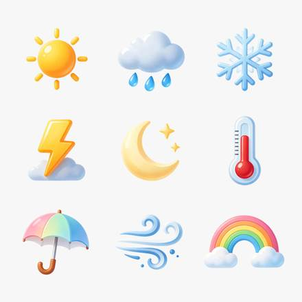

<!-- Generated from external-references/cases.json; not original model output by Raphael. -->
# 九枚透明天气图标

[English](README.md) · [简体中文](README.zh-CN.md)

[返回外部素材库](../../README.zh-CN.md)

**状态：待重做。第三方网站自报模型和结果，本站尚未独立复现。**

## 原始参考图 1



[打开来源图片](https://aws.seedreamv5.com/marketing/showcase-seedream-55-icon-set-1920.webp)

## 来源公开 Prompt

网站将以下文案标注为该结果的提示词；转载许可、生成模型和参数尚未独立审计。

```text
A set of nine weather icons arranged in a neat 3 by 3 grid: a sun, a cloud with rain, a snowflake, a lightning bolt, a crescent moon with two stars, a thermometer, an open umbrella, a wind swirl and a rainbow. A consistent rounded style with glossy, soft-gradient fills in warm and cool pastel tones, equal sizes and even spacing. Each icon is a standalone design asset on a fully transparent background, with no tiles or frames behind them and no text or letters.
```

[核对来源原文](https://seedreamv5.com/seedream-5.5)

## 重做与授权

- 来源: Seedream Studio · [https://seedreamv5.com/seedream-5.5](https://seedreamv5.com/seedream-5.5)
- 来源模型归因: site-self-reported
- 工作流: text-to-image
- 图像许可: not verified
- 重做状态: pending
- 本次重做文件数: 0

后续生成的新图请放到独立 remade 目录并更新结构化状态；对来源图片的转载应在发布前处理授权或删除。

备注：Site presents an exact prompt and the model-generated output.
