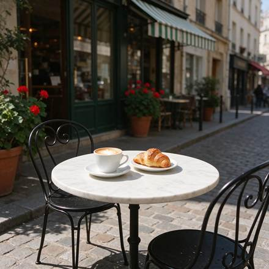
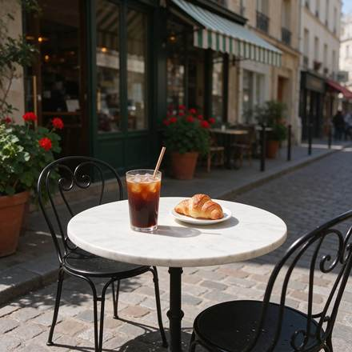
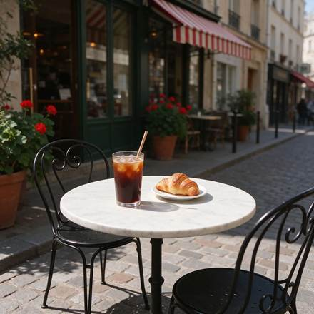
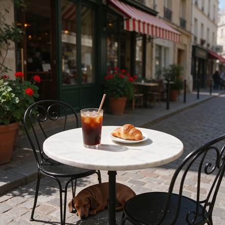

<!-- Generated from external-references/cases.json; not original model output by Raphael. -->
# Three-round café image edit

[English](README.md) · [简体中文](README.zh-CN.md)

[Back to external queue](../../README.md)

**Status: pending remake. Model and outputs are source-reported, not independently reproduced.**

## Original reference 1



[Open source image](https://aws.seedreamv5.com/marketing/showcase-seedream-55-edit-base-1920.webp)

## Original reference 2



[Open source image](https://aws.seedreamv5.com/marketing/showcase-seedream-55-edit-r1-1920.webp)

## Original reference 3



[Open source image](https://aws.seedreamv5.com/marketing/showcase-seedream-55-edit-r2-1920.webp)

## Original reference 4



[Open source image](https://aws.seedreamv5.com/marketing/showcase-seedream-55-edit-r3-1920.webp)

## Source-published prompt

The website associates this prompt with its output; license, model execution and settings were not independently audited.

```text
A sunny street café scene seen from the pavement at table height: a small round white marble bistro table holding a white ceramic cup of cappuccino with heart latte art on a saucer and a golden croissant on a small plate, with two black wrought-iron bistro chairs. Behind the table, the café front has a plain green-and-white striped awning with no lettering, tall glass windows and terracotta pots of red geraniums. A cobblestone street, warm morning sunlight, soft shadows, no people, and no text or signs anywhere. Photorealistic, 35mm lens.
```

[Check original source](https://seedreamv5.com/seedream-5.5)

## Edit sequence

### 1. Swap the cappuccino for an iced coffee

```text
Replace the cappuccino cup and saucer on the table with a tall clear glass of iced coffee with ice cubes, a paper straw and droplets of condensation, standing in the same spot. Keep everything else exactly as it is: the marble table, the croissant and its plate, both chairs, the green-and-white striped awning, the windows, the geraniums, the cobblestones, the lighting and the camera angle.
```

### 2. Turn the awning red and white

```text
Change only the colour of the awning stripes from green-and-white to red-and-white. Keep everything else exactly as it is: the glass of iced coffee, the croissant and its plate, the marble table, both chairs, the windows, the geraniums, the cobblestones, the lighting and the camera angle.
```

### 3. Add a sleeping dachshund

```text
Add a small brown dachshund lying curled up asleep on the cobblestones under the table, in the table's shadow. Keep everything else exactly as it is: the glass of iced coffee, the croissant and its plate, the marble table, both chairs, the red-and-white striped awning, the windows, the geraniums, the lighting and the camera angle.
```

## Remake and rights

- Source: Seedream Studio · [https://seedreamv5.com/seedream-5.5](https://seedreamv5.com/seedream-5.5)
- Model evidence: site-self-reported
- Workflow: multi-turn-image-edit
- Media license: not verified
- Remake status: pending
- Owned replacement files: 0

Put new outputs in the remade directory and update structured status. Clear licensing or remove source-media previews before promotion.

Notes: Successive edits each depend on the previous frame, rather than independent generations.
