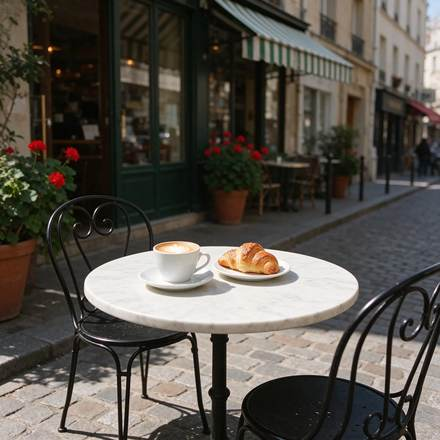
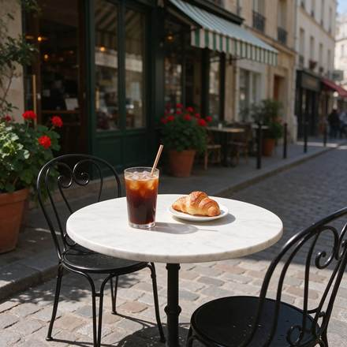
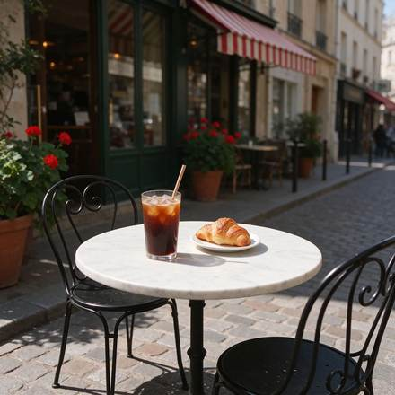
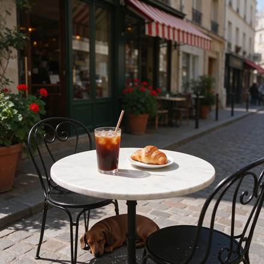

<!-- Generated from external-references/cases.json; not original model output by Raphael. -->
# 咖啡馆三轮编辑：饮品、遮阳篷和小狗

[English](README.md) · [简体中文](README.zh-CN.md)

[返回外部素材库](../../README.zh-CN.md)

**状态：待重做。第三方网站自报模型和结果，本站尚未独立复现。**

## 原始参考图 1



[打开来源图片](https://aws.seedreamv5.com/marketing/showcase-seedream-55-edit-base-1920.webp)

## 原始参考图 2



[打开来源图片](https://aws.seedreamv5.com/marketing/showcase-seedream-55-edit-r1-1920.webp)

## 原始参考图 3



[打开来源图片](https://aws.seedreamv5.com/marketing/showcase-seedream-55-edit-r2-1920.webp)

## 原始参考图 4



[打开来源图片](https://aws.seedreamv5.com/marketing/showcase-seedream-55-edit-r3-1920.webp)

## 来源公开 Prompt

网站将以下文案标注为该结果的提示词；转载许可、生成模型和参数尚未独立审计。

```text
A sunny street café scene seen from the pavement at table height: a small round white marble bistro table holding a white ceramic cup of cappuccino with heart latte art on a saucer and a golden croissant on a small plate, with two black wrought-iron bistro chairs. Behind the table, the café front has a plain green-and-white striped awning with no lettering, tall glass windows and terracotta pots of red geraniums. A cobblestone street, warm morning sunlight, soft shadows, no people, and no text or signs anywhere. Photorealistic, 35mm lens.
```

[核对来源原文](https://seedreamv5.com/seedream-5.5)

## 连续编辑步骤

### 1. Swap the cappuccino for an iced coffee

```text
Replace the cappuccino cup and saucer on the table with a tall clear glass of iced coffee with ice cubes, a paper straw and droplets of condensation, standing in the same spot. Keep everything else exactly as it is: the marble table, the croissant and its plate, both chairs, the green-and-white striped awning, the windows, the geraniums, the cobblestones, the lighting and the camera angle.
```

### 2. Turn the awning red and white

```text
Change only the colour of the awning stripes from green-and-white to red-and-white. Keep everything else exactly as it is: the glass of iced coffee, the croissant and its plate, the marble table, both chairs, the windows, the geraniums, the cobblestones, the lighting and the camera angle.
```

### 3. Add a sleeping dachshund

```text
Add a small brown dachshund lying curled up asleep on the cobblestones under the table, in the table's shadow. Keep everything else exactly as it is: the glass of iced coffee, the croissant and its plate, the marble table, both chairs, the red-and-white striped awning, the windows, the geraniums, the lighting and the camera angle.
```

## 重做与授权

- 来源: Seedream Studio · [https://seedreamv5.com/seedream-5.5](https://seedreamv5.com/seedream-5.5)
- 来源模型归因: site-self-reported
- 工作流: multi-turn-image-edit
- 图像许可: not verified
- 重做状态: pending
- 本次重做文件数: 0

后续生成的新图请放到独立 remade 目录并更新结构化状态；对来源图片的转载应在发布前处理授权或删除。

备注：Successive edits each depend on the previous frame, rather than independent generations.
