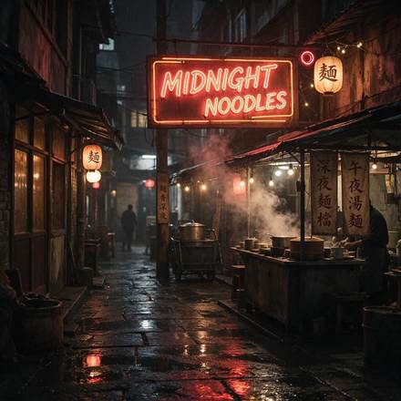

<!-- Generated from external-references/cases.json; not original model output by Raphael. -->
# A sign with exact words

[English](README.md) · [简体中文](README.zh-CN.md)

[Back to external queue](../../README.md)

**Status: pending remake. Model and outputs are source-reported, not independently reproduced.**

## Original reference 1



[Open source image](https://vdobloom.com/api/uploads/r2/file?key=model_tests/2026-11/seedream-5-5/prompt-sign.jpg)

## Source-published prompt

The website associates this prompt with its output; license, model execution and settings were not independently audited.

```text
A neon sign glowing in a rainy night alley that reads "MIDNIGHT NOODLES", steam rising from a food stall below, reflections on wet pavement, cinematic photo.
```

[Check original source](https://vdobloom.com/blog/seedream-5-5-prompt-guide/)

## Remake and rights

- Source: VdoBloom · [https://vdobloom.com/blog/seedream-5-5-prompt-guide/](https://vdobloom.com/blog/seedream-5-5-prompt-guide/)
- Model evidence: site-self-reported
- Workflow: text-to-image
- Media license: not verified
- Remake status: pending
- Owned replacement files: 0

Put new outputs in the remade directory and update structured status. Clear licensing or remove source-media previews before promotion.

Notes: VdoBloom claims first-take sample images and shows prompts; independent model execution not audited.
