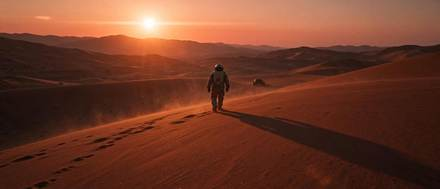

<!-- Generated from external-references/cases.json; not original model output by Raphael. -->
# 荒漠宇航员超宽幅电影剧照

[English](README.md) · [简体中文](README.zh-CN.md)

[返回外部素材库](../../README.zh-CN.md)

**状态：待重做。第三方网站自报模型和结果，本站尚未独立复现。**

## 原始参考图 1



[打开来源图片](https://vdobloom.com/api/uploads/r2/file?key=model_tests/2026-11/seedream-5-5/prompt-cinematic.jpg)

## 来源公开 Prompt

网站将以下文案标注为该结果的提示词；转载许可、生成模型和参数尚未独立审计。

```text
A lone astronaut walking across red desert dunes at sunset, long shadow, a small rover far behind, dust in the air, cinematic wide shot, anamorphic look.
```

[核对来源原文](https://vdobloom.com/blog/seedream-5-5-prompt-guide/)

## 重做与授权

- 来源: VdoBloom · [https://vdobloom.com/blog/seedream-5-5-prompt-guide/](https://vdobloom.com/blog/seedream-5-5-prompt-guide/)
- 来源模型归因: site-self-reported
- 工作流: text-to-image
- 图像许可: not verified
- 重做状态: pending
- 本次重做文件数: 0

后续生成的新图请放到独立 remade 目录并更新结构化状态；对来源图片的转载应在发布前处理授权或删除。

备注：VdoBloom claims first-take sample images and shows prompts; independent model execution not audited.
